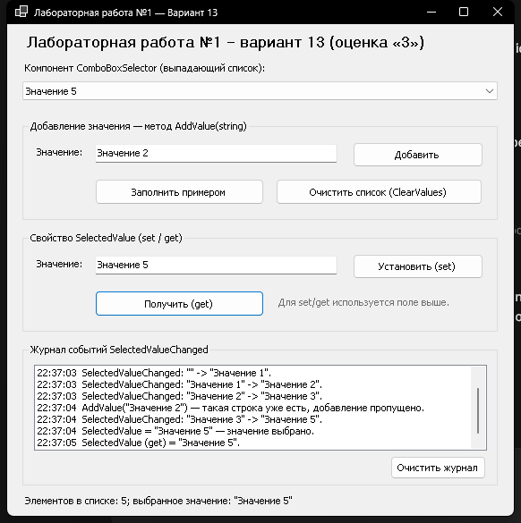

# Лабораторная работа №1. Создание визуального компонента

**Вариант 13, оценка «удовлетворительно» (3).**
Выполнил: Кирюшин А. П., группа ПИБД-23.

## 1. Задание и что реализовано

По заданию варианта 13 требуется реализовать компонент из блока **«Визуальный
компонент выбора»**:

> Выпадающий список. Список заполняется через метод, передающий строку.

Для оценки «удовлетворительно» достаточно только этого компонента, поэтому
блоки «Визуальный компонент ввода» и «Визуальный компонент вывода списков» в
работе не реализуются.

| Требование варианта | Реализация |
|---|---|
| Выпадающий список на основе `ComboBox` | `ComboBoxSelector` |
| Заполнение методом, принимающим строку | `AddValue(string value)` |
| Добавление только уникальных непустых строк | проверка в `AddValue` |
| Отдельный метод очистки списка | `ClearValues()` |
| Свойство выбранного значения (`set`/`get`) | `SelectedValue` |
| Событие при смене значения | `SelectedValueChanged` |
| Приложение для проверки компонента | проект `Lab1.TestApp` |

## 2. Состав решения

```
lab1/
├── Lab1.sln
├── NuGet.config                    # локальный источник NuGet-пакетов
├── README.md
├── nuget-feed/                     # папка-источник с собранным .nupkg
└── src/
    ├── SelectionControlLibrary/      # библиотека визуальных компонентов
    │   ├── ComboBoxSelector.cs
    │   ├── ComboBoxSelector.Designer.cs
    │   ├── ComboBoxSelector.resx
    │   └── SelectedValueChangedEventArgs.cs
    └── Lab1.TestApp/                 # приложение для проверки компонента
        ├── MainForm.cs
        ├── MainForm.Designer.cs
        ├── MainForm.resx
        └── Program.cs
```

* **SelectionControlLibrary** — библиотека классов Windows Forms
  (`.NET 9`, `net9.0-windows`). При сборке создаётся NuGet-пакет
  `SelectionControlLibrary.Kiryushin.1.0.0.nupkg`.
* **Lab1.TestApp** — исполняемое приложение Windows Forms, которое проверяет
  все методы, свойства и события компонента.

## 3. Сборка и запуск

Требования: Windows, .NET 9 SDK (или новее), Visual Studio 2022 — по желанию.

Через командную строку:

```powershell
dotnet build lab1/Lab1.sln
dotnet run --project lab1/src/Lab1.TestApp
```

Через Visual Studio 2022:

1. Открыть `lab1/Lab1.sln`.
2. Назначить проект `Lab1.TestApp` запускаемым.
3. Нажать `F5`.

После сборки библиотеки компонент `ComboBoxSelector` появляется в панели
элементов, и его можно перетащить на форму.

### Подключение через локальный NuGet-пакет

В `lab1/NuGet.config` уже добавлен локальный источник `Lab1Local`, который
указывает на папку `lab1/nuget-feed`. Тестовое приложение подключает компонент
как NuGet-пакет:

```xml
<PackageReference Include="SelectionControlLibrary.Kiryushin" Version="1.0.0" />
```

Актуальный пакет лежит в
`lab1/nuget-feed/SelectionControlLibrary.Kiryushin.1.0.0.nupkg`. При сборке
библиотеки пакет также создаётся в
`lab1/src/SelectionControlLibrary/bin/<Configuration>/SelectionControlLibrary.Kiryushin.1.0.0.nupkg`.

Если библиотека изменилась, обновите пакет в локальном источнике:

```powershell
dotnet pack lab1/src/SelectionControlLibrary/SelectionControlLibrary.csproj -c Release -o lab1/nuget-feed
```

При изменении версии обновите `<Version>` в
`SelectionControlLibrary.csproj` и `Version` в `PackageReference` тестового
приложения, затем выполните `dotnet restore --force`. В Visual Studio локальный
источник уже настроен через `NuGet.config`, отдельно добавлять его в параметрах
не нужно.

Проверить подключение пакета:

```powershell
dotnet list lab1/src/Lab1.TestApp/Lab1.TestApp.csproj package
```

## 4. Описание компонента `ComboBoxSelector`

Пространство имён: `SelectionControlLibrary`.
Базовый класс: `System.Windows.Forms.UserControl`.
Внутри размещён `ComboBox` со стилем `DropDownList`, растянутый по всем краям
компонента (`Dock = Fill`).

### 4.1. Свойства

| Свойство | Тип | Доступ | Описание |
|---|---|---|---|
| `SelectedValue` | `string` | `get` / `set` | Выбранное значение. `get` возвращает пустую строку, если ничего не выбрано. `set` выбирает строку, если она есть в списке; пустая строка или `null` сбрасывают выбор; отсутствующая в списке строка также сбрасывает выбор. |
| `ItemCount` | `int` | `get` | Количество строк в списке. В окне свойств не показывается (`[Browsable(false)]`). |

### 4.2. Методы

| Метод | Описание |
|---|---|
| `void AddValue(string value)` | Добавляет строку в конец списка, если такой строки ещё нет. Повторное добавление игнорируется. Если `value` равен `null`, пуст или состоит только из пробелов, выбрасывается `ArgumentException`. |
| `void ClearValues()` | Полностью очищает список значений. |

Сравнение строк при проверке дубликатов — точное, с учётом регистра.

### 4.3. События

| Событие | Аргументы | Описание |
|---|---|---|
| `SelectedValueChanged` | `EventHandler<SelectedValueChangedEventArgs>` | Возникает при изменении выбранного значения (в том числе при сбросе выбора). |

Свойства аргументов события:

| Свойство | Тип | Описание |
|---|---|---|
| `OldValue` | `string` | Предыдущее выбранное значение (`""`, если выбора не было). |
| `NewValue` | `string` | Новое выбранное значение (`""`, если выбор сброшен). |

### 4.4. Пример использования

```csharp
using SelectionControlLibrary;

var selector = new ComboBoxSelector();

// Заполнение списка методом, принимающим строку.
selector.AddValue("Значение 1");
selector.AddValue("Значение 2");
selector.AddValue("Значение 1"); // дубликат — не добавится
selector.AddValue("Значение 3");

// Получение и установка выбранного значения.
selector.SelectedValue = "Значение 2";
string current = selector.SelectedValue; // "Значение 2"

// Подписка на событие смены значения.
selector.SelectedValueChanged += (sender, e) =>
{
    Console.WriteLine($"Было: \"{e.OldValue}\", стало: \"{e.NewValue}\"");
};

// Очистка списка.
selector.ClearValues();
```

Обработка ошибки пустой строки:

```csharp
try
{
    selector.AddValue("   ");
}
catch (ArgumentException ex)
{
    MessageBox.Show(ex.Message);
}
```

## 5. Приложение для проверки

Окно тестового приложения:



Форма `MainForm` содержит компонент и элементы управления для проверки всех
членов его API:

1. **«Добавить»** — вызывает `AddValue` со строкой из текстового поля.
   Повторное добавление существующей строки не создаёт дубликат и
   отображается в журнале. Пустая строка или строка из пробелов вызывает
   предупреждение.
2. **«Заполнить примером»** — добавляет «Значение 1» … «Значение 5» и повторно
   передаёт «Значение 1», чтобы показать пропуск дубликата.
3. **«Очистить список (ClearValues)»** — вызывает `ClearValues()`.
4. **«Установить (set)»** — записывает строку из поля в `SelectedValue`.
   Если строки нет в списке, выбор сбрасывается.
5. **«Получить (get)»** — читает `SelectedValue` и выводит результат в поле и
   журнал.
6. **Журнал событий** — показывает каждое срабатывание
   `SelectedValueChanged` с прежним и новым значением.
7. **Строка состояния** — показывает текущее количество элементов и выбранное
   значение.

Все действия протоколируются в журнале, что позволяет проверить работу
свойств, методов и события без отладчика.

## 6. Краткий вывод

В ходе работы создана библиотека визуальных компонентов Windows Forms и
компонент выбора `ComboBoxSelector`, реализующий требования варианта 13.
Компонент инкапсулирует `ComboBox`, предоставляет методы заполнения и очистки
списка, свойство выбранного значения и событие его изменения. Работоспособность
проверена отдельным приложением `Lab1.TestApp`.
