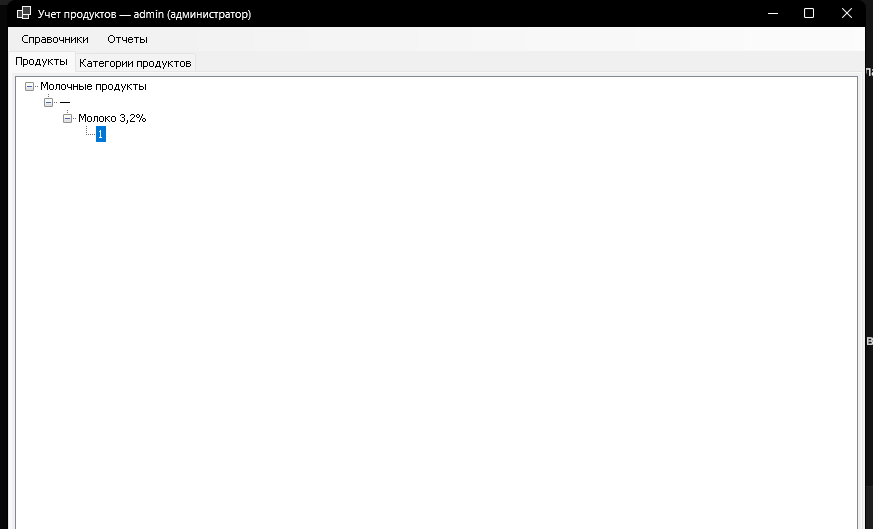

# Лабораторная работа №2. Разработка программы с компонентно-ориентированным подходом

**Вариант 13, оценка «удовлетворительно» (3).**
Выполнил: Кирюшин А. П., группа ПИБД-23.

## 1. Задание и что реализовано

Вариант 13 — **учёт продуктов в магазине**:

* название;
* описание;
* категория изделия — выпадающий список (компонент выбора);
* количество на складе — может отсутствовать (компонент ввода);
* вывод в виде дерева: **категория → количество → название → идентификатор**
  (компонент вывода списков);
* отчёт по продуктам выбранной категории.

Для оценки «3» компоненты созданы **в одном решении** с основным приложением и
проектом-контрактом. Загрузка компонентов выполняется **через рефлексию**,
каталог DLL задаётся в файле конфигурации. Доступ к компонентам определяется
**авторизацией по логину** — без хранения пользователей и ролей в БД.

## 2. Архитектура решения

Используется компонентный подход:

```
ComponentOrientedPlatform          — контракт IComponentContract
        ▲
        │ реализуют
┌───────┴─────────────────────────────────────────────┐
│ ProductCatalog.Components.SimpleDirectory           │ — простой справочник
│ ProductCatalog.Components.ProductDirectory          │ — сложный справочник
│ ProductCatalog.Components.ProductReport             │ — отчёт
└───────┬─────────────────────────────────────────────┘
        │ загружаются через рефлексию из папки Components
        ▼
ComponentHost                      — основное приложение
        │
        ├── ProductCatalog.Data    — SQLite: категории и продукты
        └── SelectionControlLibrary — визуальные компоненты из лабы №1
```

Основное приложение **не ссылается на сборки компонентов на этапе
компиляции**. Оно знает только контракт `IComponentContract`, а конкретные
реализации загружает из каталога, указанного в `appsettings.json`.

## 3. Состав решения

```
lab2/
├── Lab2.sln
├── README.md
├── docs/
│   └── screenshot.png
└── src/
    ├── ComponentOrientedPlatform/                  # контракт
    │   └── IComponentContract.cs
    ├── ProductCatalog.Data/                        # SQLite и репозитории
    │   ├── Database.cs
    │   ├── Product.cs
    │   ├── CategoryRepository.cs
    │   └── ProductRepository.cs
    ├── Components/
    │   ├── ProductCatalog.Components.SimpleDirectory/
    │   │   ├── SimpleDirectoryComponent.cs
    │   │   ├── SimpleDirectoryControl.cs
    │   │   └── SimpleDirectoryControl.Designer.cs
    │   ├── ProductCatalog.Components.ProductDirectory/
    │   │   ├── ProductDirectoryComponent.cs
    │   │   ├── ProductDirectoryControl.cs
    │   │   ├── ProductEditForm.cs
    │   │   └── ProductEditForm.Designer.cs
    │   └── ProductCatalog.Components.ProductReport/
    │       ├── ProductReportComponent.cs
    │       └── ProductReportControl.cs
    └── ComponentHost/                              # основное приложение
        ├── Program.cs
        ├── LoginForm.cs
        ├── MainForm.cs
        ├── ComponentLoader.cs
        └── appsettings.json
```

Дополнительно в решении используется проект `lab1/src/SelectionControlLibrary`
из лабораторной №1. В нём к имеющемуся `ComboBoxSelector` добавлены:

* `NullableIntInput` — ввод целого числа с возможностью указать `null`;
* `TreeViewPresenter` — вывод объектов в виде дерева по иерархии свойств.

## 4. Контракт компонента

```csharp
public interface IComponentContract
{
    string Id { get; }
    string Title { get; }
    ComponentSection Section { get; }
    AccessLevel MinimumAccessLevel { get; }
    UserControl CreateControl();
}
```

* `Section` — раздел меню: `Directories` («Справочники») или `Reports` («Отчёты»).
* `MinimumAccessLevel` — минимальная роль: `Minimal`, `Basic`, `Advanced`.
* `CreateControl()` возвращает новый экземпляр `UserControl`; поэтому каждое
  открытие пункта меню создаёт отдельную вкладку с независимым контролом.

## 5. Авторизация и правила доступа

Логин вводится в отдельной форме `LoginForm`. Пароль и БД не используются —
роль определяется только по логину:

| Логин | Роль | Доступные компоненты |
|---|---|---|
| `admin` | `Advanced` | «Категории продуктов», «Продукты», «Отчёт по категории продуктов» |
| `user` | `Basic` | «Категории продуктов», «Продукты» |
| любой другой непустой | `Minimal` | только «Категории продуктов» |
| пустой | — | вход запрещён |

Основное приложение фильтрует компоненты по
`component.MinimumAccessLevel <= текущая роль` и не добавляет недоступные
пункты в меню.

## 6. Компоненты

### 6.1. Простой справочник «Категории продуктов»

`ProductCatalog.Components.SimpleDirectory`.

* `UserControl` целиком заполнен `DataGridView` с **одной колонкой**
  «Категория».
* `Insert` — добавляет новую строку и сразу начинает редактирование.
* Сохранение — по `Enter` или при переходе к другой ячейке/записи
  (`CellEndEdit`).
* Пустая строка не сохраняется: `CellValidating` отменяет уход из ячейки.
* `Delete` — удаление выбранных строк с подтверждением
  «Удалить выбранные записи?».
* `F5` — перечитать справочник из БД.
* Категории хранятся в SQLite и используются остальными компонентами.

### 6.2. Сложный справочник «Продукты»

`ProductCatalog.Components.ProductDirectory`.

* Основной элемент — `TreeViewPresenter`, заполненный продуктами.
  Иерархия: **категория → количество → название → идентификатор**.
  Если количество не задано, выводится «—».
* Контекстное меню: «Добавить», «Редактировать», «Удалить», «Обновить».
* Горячие клавиши:
  * `Ctrl+A` — добавить;
  * `Ctrl+U` — редактировать выбранный продукт;
  * `Ctrl+D` — удалить выбранный продукт;
  * `F5` — обновить дерево.
* Удаление — только после подтверждения.
* Форма `ProductEditForm`:
  * название — стандартный `TextBox`;
  * описание — многострочный `TextBox`;
  * категория — визуальный компонент `ComboBoxSelector` из лабы №1,
    заполняется категориями из БД;
  * количество — визуальный компонент `NullableIntInput` с флажком
    «Нет значения»;
  * идентификатор в форму не выводится.
* При редактировании все поля заполняются значениями продукта.
* При попытке закрыть форму с несохранёнными изменениями выводится
  предупреждение с выбором «Да/Нет».

### 6.3. Отчёт «Отчёт по категории продуктов»

`ProductCatalog.Components.ProductReport`.

* `UserControl` содержит стандартный `ComboBox` для выбора категории,
  кнопку «Сформировать» и `DataGridView` для вывода результата.
* Отчёт показывает продукты выбранной категории: идентификатор, название,
  описание, категория, количество.
* Список категорий для фильтра объединяет категории справочника и категории,
  уже встречающиеся у продуктов.
* Доступен только роли `Advanced` (`admin`).

## 7. Визуальные компоненты из лабораторной №1

| Компонент | Где используется |
|---|---|
| `ComboBoxSelector` | выбор категории в форме продукта |
| `NullableIntInput` | ввод количества на складе (nullable int) |
| `TreeViewPresenter` | вывод продуктов в виде дерева |

`TreeViewPresenter` использует рефлексию: по именам публичных свойств/полей
строит уровни дерева и привязывает исходный объект к конечному узлу. Для
продукта задаётся иерархия `Category`, `Quantity`, `Name`, `Id`.

## 8. База данных

Используется локальная SQLite-база `Microsoft.Data.Sqlite`.

Файл БД создаётся рядом с исполняемым файлом:
`lab2/src/ComponentHost/bin/<Configuration>/net9.0-windows/productcatalog.db`.

Схема:

```sql
CREATE TABLE Categories (
    Id   INTEGER PRIMARY KEY AUTOINCREMENT,
    Name TEXT NOT NULL UNIQUE
);

CREATE TABLE Products (
    Id          INTEGER PRIMARY KEY AUTOINCREMENT,
    Name        TEXT NOT NULL,
    Description TEXT NOT NULL DEFAULT '',
    Category    TEXT NOT NULL,
    Quantity    INTEGER NULL
);
```

Категория в продукте хранится **как текст**, без внешнего ключа — как требует
задание. При первом создании БД добавляются стартовые категории
(«Молочные продукты», «Хлебобулочные изделия», «Напитки», «Бакалея»).

Чтобы сбросить данные, удалите файл `productcatalog.db` и запустите приложение
снова.

## 9. Загрузка компонентов

Файл `appsettings.json`:

```json
{
  "ComponentDirectory": "Components"
}
```

`ComponentLoader`:

1. читает путь из конфигурации;
2. перебирает `*.dll` в каталоге;
3. загружает сборки через `Assembly.LoadFrom`;
4. через рефлексию находит типы, реализующие `IComponentContract`;
5. создаёт экземпляры через `Activator.CreateInstance`.

DLL компонентов при сборке автоматически копируются в
`ComponentHost/bin/<Configuration>/net9.0-windows/Components` из
соответствующих проектов. Основное приложение не использует типы компонентов;
ссылки на их проекты нужны только для порядка сборки (`ReferenceOutputAssembly=false`)
и не подключают сборки компонентов как зависимости.

## 10. Сборка и запуск

Требования: Windows, .NET 9 SDK, доступ к nuget.org для первого восстановления
`Microsoft.Data.Sqlite` (или уже заполненный NuGet-кэш).

```powershell
dotnet build lab2/Lab2.sln
dotnet run --project lab2/src/ComponentHost/ComponentHost.csproj
```

Или открыть `lab2/Lab2.sln` в Visual Studio 2022, назначить запускаемым проект
`ComponentHost` и нажать `F5`.

Перед повторной сборкой закройте запущенное приложение: DLL компонентов в
папке `Components` могут быть заняты процессом.

## 11. Проверка работы

1. Запустить приложение, войти под `admin`.
2. Открыть «Справочники → Категории продуктов»: должны отобразиться
   стартовые категории. Проверить `Insert`, редактирование и `Delete`.
3. Открыть «Справочники → Продукты». Через контекстное меню или `Ctrl+A`
   добавить продукт: название, описание, категорию, количество (или отметить
   «Нет значения»). Убедиться, что продукт появился в дереве.
4. Проверить `Ctrl+U`, `Ctrl+D`, подтверждение удаления и предупреждение о
   несохранённых изменениях.
5. Открыть «Отчёты → Отчёт по категории продуктов», выбрать категорию и
   нажать «Сформировать».
6. Выйти и войти под `user`: пункт «Отчёты» должен отсутствовать.
7. Войти под произвольным логином (например, `guest`): должен остаться только
   пункт «Категории продуктов».

Окно приложения:



## 12. Краткий вывод

В работе реализовано Windows Forms-приложение на основе компонентного подхода:
контракт вынесен в отдельный проект, три компонента реализуют его и
загружаются через рефлексию из каталога, задаваемого конфигурацией. Правила
доступа определяются ролью пользователя, полученной при авторизации. Для
хранения справочника категорий и продуктов используется SQLite. В компонентах
повторно применены визуальные компоненты из лабораторной №1, а библиотека
дополнена компонентами ввода nullable-числа и вывода дерева.
