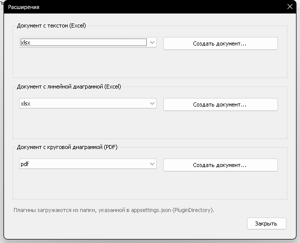

# Лабораторная работа №3. Разработка программы с плагинами

**Вариант 13, оценка «удовлетворительно» (3).**
Выполнил: Кирюшин А. П., группа ПИБД-23.

## 1. Задание и что реализовано

Лабораторная работа выполнена на основе проекта лабораторной №2. В приложение
`ComponentHost` добавлены:

* отдельная библиотека контрактов плагинов `PluginsContracts`;
* три проекта-плагина формирования документов;
* загрузка плагинов через рефлексию из папки, указанной в конфигурации;
* форма «Расширения» с тремя блоками «выпадающий список формата + кнопка
  создания документа»;
* пункт меню **«Отчеты → Расширения»**.

Для варианта 13 плагины формируют:

| Документ | Формат | Плагин |
|---|---|---|
| Документ с большим текстом: продукты в наличии | Excel (`xlsx`) | `ProductCatalog.Plugins.TextExcel` |
| Документ с линейной диаграммой: отсутствующие продукты по категориям | Excel (`xlsx`) | `ProductCatalog.Plugins.LineChartExcel` |
| Документ с круговой диаграммой: отсутствующие продукты по категориям | PDF (`pdf`) | `ProductCatalog.Plugins.PieChartPdf` |

> В таблице варианта для контракта с диаграммой указана линейная диаграмма в
> Excel, а в тексте задания — круговая диаграмма в PDF. Чтобы покрыть оба
> требования, реализованы **оба варианта диаграммы**. Для оценки «3» достаточно
> первого документа и любого документа с диаграммой.

Третий контракт варианта — таблица со сложной шапкой — для оценки «3» не
требуется (он относится к оценкам «4»/«5»), поэтому в работе не реализован.

## 2. Архитектура

```
PluginsContracts                     — контракты плагинов
        ▲
        │ реализуют
┌───────┴──────────────────────────────────────────────┐
│ ProductCatalog.Plugins.TextExcel                     │
│ ProductCatalog.Plugins.LineChartExcel                │
│ ProductCatalog.Plugins.PieChartPdf                   │
└───────┬──────────────────────────────────────────────┘
        │ DLL загружаются через рефлексию из папки Plugins
        ▼
ComponentHost (проект лабы №2)
        ├── ExtensionsForm           — форма «Расширения»
        ├── PluginLoader             — поиск реализаций контрактов
        ├── ProductCatalog.Data      — данные о продуктах
        └── appsettings.json         — пути к Components и Plugins
```

Плагины не зависят от `ComponentHost` и от `ProductCatalog.Data`: основное
приложение само готовит данные и передаёт их в методы контрактов.

## 3. Контракты плагинов

`PluginsContracts` содержит:

```csharp
public interface IReportDocumentContract
{
    string DocumentFormat { get; }
}

public interface IReportDocumentWithContextTextsContract : IReportDocumentContract
{
    Task CreateDocumentAsync(string filePath, string header, List<string> paragraphs);
}

public interface IReportDocumentWithChartLineContract : IReportDocumentContract
{
    Task CreateDocumentAsync(
        string filePath,
        string header,
        string chartTitle,
        Dictionary<string, List<(int Parameter, double Value)>> series);
}

public interface IReportDocumentWithChartPieContract : IReportDocumentContract
{
    Task CreateDocumentAsync(
        string filePath,
        string header,
        string chartTitle,
        string seriesName,
        List<(string Parameter, double Value)> series);
}
```

## 4. Плагины

### 4.1. Документ с текстом — Excel

`TextExcelReportPlugin` (`ProductCatalog.Plugins.TextExcel`).

* `DocumentFormat = "xlsx"`.
* Принимает заголовок и список абзацев.
* Создаёт Excel-книгу: заголовок в первой строке, каждый абзац — отдельной
  строкой с переносом текста.
* Основное приложение передаёт по одному абзацу на каждый продукт, который
  есть в наличии: название и описание.

### 4.2. Документ с линейной диаграммой — Excel

`LineChartExcelReportPlugin` (`ProductCatalog.Plugins.LineChartExcel`).

* `DocumentFormat = "xlsx"`.
* Принимает словарь серий. Для варианта 13 каждая серия — категория продукта,
  а её единственное значение — количество отсутствующих продуктов.
* Создаёт лист с таблицей «Категория — Количество» и вставляет изображение
  линейной диаграммы, построенной по этим данным.

### 4.3. Документ с круговой диаграммой — PDF

`PieChartPdfReportPlugin` (`ProductCatalog.Plugins.PieChartPdf`).

* `DocumentFormat = "pdf"`.
* Принимает список пар «категория — количество».
* Формирует круговую диаграмму и PDF-документ с заголовком, диаграммой и
  таблицей значений.
* Для PDF используется QuestPDF, для диаграммы — `System.Drawing`.

## 5. Интеграция в приложение

В основном приложении добавлены:

* `PluginLoader` — читает `PluginDirectory` из `appsettings.json`, загружает
  `ProductCatalog.Plugins.*.dll` через `Assembly.LoadFrom`, находит реализации
  трёх контрактов и создаёт их экземпляры;
* `ExtensionsForm` — три блока:
  * «Документ с текстом (Excel)»;
  * «Документ с линейной диаграммой (Excel)»;
  * «Документ с круговой диаграммой (PDF)».
  В каждом блоке выпадающий список заполняется значениями `DocumentFormat`
  найденных плагинов, а кнопка открывает `SaveFileDialog` и вызывает
  `CreateDocumentAsync`;
* пункт меню **«Отчеты → Расширения»** (доступен роли `admin`, как и отчёты
  в лабораторной №2).

Конфигурация `lab2/src/ComponentHost/appsettings.json`:

```json
{
  "ComponentDirectory": "Components",
  "PluginDirectory": "Plugins"
}
```

Плагины при сборке автоматически копируются:

* сами DLL — в `ComponentHost/bin/<Configuration>/net9.0-windows/Plugins`;
* зависимости плагинов (ClosedXML, QuestPDF, System.Drawing.Common, native
  библиотеки QuestPDF) — в каталог основного приложения.

Поэтому основное приложение не ссылается на реализации плагинов на этапе
компиляции: ссылки на проекты плагинов используются только для порядка сборки
(`ReferenceOutputAssembly=false`).

## 6. Состав решения

```
lab3/
├── Lab3.sln
├── README.md
├── docs/
│   └── screenshot.png
└── src/
    ├── PluginsContracts/
    │   └── IReportDocumentContract.cs
    ├── ProductCatalog.Plugins.TextExcel/
    │   └── TextExcelReportPlugin.cs
    ├── ProductCatalog.Plugins.LineChartExcel/
    │   └── LineChartExcelReportPlugin.cs
    └── ProductCatalog.Plugins.PieChartPdf/
        └── PieChartPdfReportPlugin.cs
```

Решение `Lab3.sln` также включает проекты лабораторных №1 и №2:

* `lab1/src/SelectionControlLibrary` — визуальные компоненты;
* `lab2/src/ComponentOrientedPlatform` — контракт компонентов;
* `lab2/src/ProductCatalog.Data` — SQLite;
* `lab2/src/Components/*` — три компонента;
* `lab2/src/ComponentHost` — основное приложение.

## 7. Сборка и запуск

Требования: Windows, .NET 9 SDK, доступ к nuget.org для восстановления
`ClosedXML`, `QuestPDF` и `System.Drawing.Common` (или заполненный NuGet-кэш).
`ClosedXML` распространяется по лицензии MIT, `QuestPDF` используется в
некоммерческом режиме (`LicenseType.Community`) в учебных целях.

```powershell
dotnet build lab3/Lab3.sln
dotnet run --project lab2/src/ComponentHost/ComponentHost.csproj
```

Или открыть `lab3/Lab3.sln` в Visual Studio 2022, назначить запускаемым
`ComponentHost` и нажать `F5`.

Перед повторной сборкой закройте приложение: DLL плагинов в папке `Plugins`
могут быть заняты процессом.

## 8. Проверка работы

1. Запустить приложение и войти под `admin`.
2. При необходимости добавить продукты через «Справочники → Продукты»
   (у части продуктов указать количество, у части — «Нет значения»).
3. Открыть «Отчеты → Расширения».
4. В каждом блоке выбрать формат (`xlsx` или `pdf`) и нажать
   «Создать документ...».
5. Выбрать путь сохранения. Документ будет сформирован плагином.
6. Для текстового документа в Excel должны быть строки с названием и
   описанием продуктов, которые есть в наличии.
7. Для документов с диаграммами данные берутся по продуктам, у которых
   количество не задано или равно нулю, сгруппированным по категориям.

Проверено:

* загрузка всех трёх плагинов через рефлексию;
* отображение форматов `xlsx`, `xlsx`, `pdf` в форме «Расширения»;
* создание Excel-документа с текстом;
* создание Excel-документа с линейной диаграммой;
* создание PDF-документа с круговой диаграммой;
* корректность файлов: Excel содержит данные и изображение диаграммы, PDF
  открывается и содержит одну страницу.

Окно формы «Расширения»:



## 9. Краткий вывод

В работе реализована плагинная архитектура: контракты вынесены в отдельную
библиотеку, реализации плагинов собираются отдельными проектами и
загружаются основным приложением через рефлексию из каталога, заданного
конфигурацией. Для варианта 13 реализованы текстовый Excel-документ и два
варианта документа с диаграммой (линейная в Excel и круговая в PDF), что
покрывает как таблицу варианта, так и текстовое описание задания.
